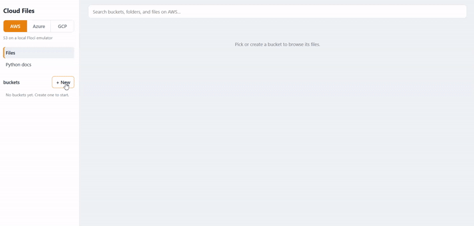

# Cloud Files

One file manager, three clouds, zero cloud accounts.

React + FastAPI frontend and backend, backed by [Floci](https://floci.io) local emulators for AWS S3, Azure Blob Storage, and GCP Cloud Storage.



## Quick start

```bash
docker compose up --build
```

Open [http://localhost:3000](http://localhost:3000).

## Features

- Browse buckets/containers, folders, and files across all three clouds
- Upload, download, and delete files and folders
- Copy and move files between buckets (drag-and-drop or context menu)
- Search across buckets, folders, and files as you type
- Shareable pre-signed/SAS links with configurable expiry
- File preview for images, PDFs, video, audio, and text
- File properties panel with URI, size, type, and last-modified
- Persistent data across restarts via Docker named volumes

## Services

| Service  | Role                        | Port |
|----------|-----------------------------|------|
| frontend | React UI (Nginx)            | 3000 |
| backend  | FastAPI proxy               | 8000 |
| floci    | AWS S3 emulator             | 4566 |
| floci-az | Azure Blob Storage emulator | 4577 |
| floci-gcp| GCP Cloud Storage emulator  | 4588 |

## Data persistence

Bucket and object data is written to Docker named volumes and survives container restarts:

| Volume          | Emulator |
|-----------------|----------|
| `floci-aws-data`| AWS S3   |
| `floci-az-data` | Azure    |
| `floci-gcp-data`| GCP      |

To wipe all stored data and start fresh:

```bash
docker compose down -v
```

> **Note:** Use `docker compose down && docker compose up` (not `docker compose restart`) for clean restarts. The `restart` command skips the health-check ordering and can start the backend before the emulators have finished replaying data from disk.

## Local development

Run the backend directly (set env vars to point at the emulators):

```bash
cd backend
AWS_ENDPOINT=http://localhost:4566 \
AZURE_ENDPOINT=http://localhost:4577 \
GCP_ENDPOINT=http://localhost:4588 \
uvicorn main:app --reload
```

Run the frontend dev server (proxies `/api` to the backend):

```bash
cd frontend
npm install
npm run dev
```

## Stack

| Layer    | Technology                                    |
|----------|-----------------------------------------------|
| Frontend | React 18, Vite, plain CSS                     |
| Backend  | Python 3.12, FastAPI, boto3, azure-storage-blob, google-cloud-storage |
| Emulators| Floci (AWS · Azure · GCP)                     |
| Serving  | Nginx (frontend), Uvicorn (backend)           |
